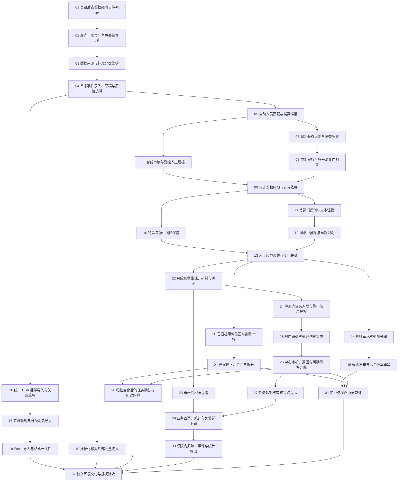

# 社会治理分析预警系统 — 实施任务

用户已确认 32 项任务的粒度、依赖与本地逐项跟踪方式。发布日期：2026-10-17。01 已实现本机业务流程并验证，Compose 运行验收仍受镜像下载阻挡；用户本轮明确指示继续 02/03，两项均已实现并验收。04–21 已实现并通过本机业务验证；22–32 尚未实现。详细状态与证据见逐项任务。

来源：[项目规格说明书](../../docs/项目规格说明书.md)。补充依据：[需求规格](../../docs/需求规格.md)、[数据模型设计](../../docs/数据模型设计.md)、[验收清单](../../docs/验收清单.md)。原拆分草案保留为审阅历史，正式任务以本目录逐项文件为准。

## 开始与完成规则

- 当前下一业务任务：**22 — 风险预警生成、研判与关闭**（04–21 已完成）；01 的 Compose 验收缺口继续保留，依赖例外来自用户本轮明确继续 02/03 的指示。
- 仅当前置全部完成时，任务才进入可执行范围；下表只列直接依赖，不重复列传递依赖。
- 每个任务的 `ready-for-agent` 表示已具体化为可领取任务，不代表没有阻塞、已开发或测试通过。
- 每项包含必要的持久化、真实 API、界面和行为验证；不得拆成单独前端、后端、数据库三份交付。
- 原始留存、可信来源、权限及审计随对应业务实现；31 号提供跨业务查询，不是最后才补写审计。
- 新增渠道复用统一处理链路；新增规则或变更行为须验证对已实现链路的影响。
- 完成时勾选有证据的验收项，记录实际验证及结果，并将任务状态更新为 `done`；无需关闭或修改来源规格。
- 实现细节选择、偏离或未解决事项追加到各任务的 Comments 中，不能把任意新增规则冒充已确认需求。

## 任务索引

| 编号 | 任务 | 直接前置 |
|---|---|---|
| 01 | [登录后查看权限内事件列表](issues/01-login-event-list.md) | 无 |
| 02 | [部门、账号与角色兼任管理](issues/02-department-account-roles.md) | 01 |
| 03 | [数据来源与标准分类维护](issues/03-sources-classifications.md) | 02 |
| 04 | [单条事件录入、草稿与原始追溯](issues/04-event-entry-provenance.md) | 03 |
| 05 | [自动人员匹配与档案详情](issues/05-automatic-person-matching.md) | 04 |
| 06 | [身份审核与受控人工建档](issues/06-identity-review.md) | 05 |
| 07 | [重复候选识别与筛查配置](issues/07-duplicate-candidates.md) | 05 |
| 08 | [重复审核与多来源事件归集](issues/08-duplicate-review-consolidation.md) | 07 |
| 09 | [累计次数风险与计算依据](issues/09-count-risk-evidence.md) | 06、08 |
| 10 | [特殊来源中风险保底](issues/10-special-source-floor.md) | 09 |
| 11 | [关键词识别与文本证据](issues/11-keyword-evidence.md) | 09 |
| 12 | [误命中排除与重新识别](issues/12-keyword-exclusions.md) | 11 |
| 13 | [人工风险调整与变化失效](issues/13-manual-risk-adjustments.md) | 10、12 |
| 14 | [规则草稿与影响预览](issues/14-rule-draft-preview.md) | 13 |
| 15 | [规则发布与后台版本重算](issues/15-rule-publication-recalculation.md) | 14 |
| 16 | [统一 CSV 批量导入与失败重导](issues/16-csv-import-retry.md) | 04 |
| 17 | [来源映射与分类别名导入](issues/17-source-field-mappings.md) | 16 |
| 18 | [Excel 导入与格式一致性](issues/18-xlsx-import.md) | 17 |
| 19 | [凭据化模拟外部批量接入](issues/19-external-batch-api.md) | 04 |
| 20 | [已归档事件修正与删除审核](issues/20-event-change-review.md) | 13 |
| 21 | [档案修正、合并与拆分](issues/21-profile-merge-split.md) | 20 |
| 22 | [风险预警生成、研判与关闭](issues/22-risk-warnings.md) | 13 |
| 23 | [未研判积压提醒](issues/23-unreviewed-warning-reminders.md) | 22 |
| 24 | [单部门任务派发与最小信息授权](issues/24-task-dispatch-authorization.md) | 22 |
| 25 | [部门跟进与处理结果提交](issues/25-task-followup-submission.md) | 24 |
| 26 | [中心审核、退回与明确事件办结](issues/26-task-review-completion.md) | 25 |
| 27 | [任务超期与审核等待提示](issues/27-task-overdue-waiting.md) | 26 |
| 28 | [归档变化后的任务确认与历史保护](issues/28-task-relation-confirmation.md) | 21、26 |
| 29 | [业务首页、统计与关键词下钻](issues/29-dashboard-statistics.md) | 23、27 |
| 30 | [权限内风险、事件与统计导出](issues/30-authorized-exports.md) | 29 |
| 31 | [跨业务操作历史查询](issues/31-operation-history.md) | 15、21、26 |
| 32 | [独立环境交付与规模验收](issues/32-delivery-scale-verification.md) | 18、19、28、30、31 |

## 依赖图

箭头方向为“前置任务 → 被阻塞任务”。

## 实现时需明示

具体框架和 Java 版本、相似度初始阈值、端点及状态编码在实现时记录。退回补充后的期限计算尚未单独约定，27 号应明确处理方式并验证，不得默认为已批准新增宽限期。规模验收需记录环境与实测结果，不编造响应时间承诺。

- [12–19 规则治理、文件导入与外部接入交付记录](../../docs/12-19-规则与批量接入.md)：全量51项测试通过。
