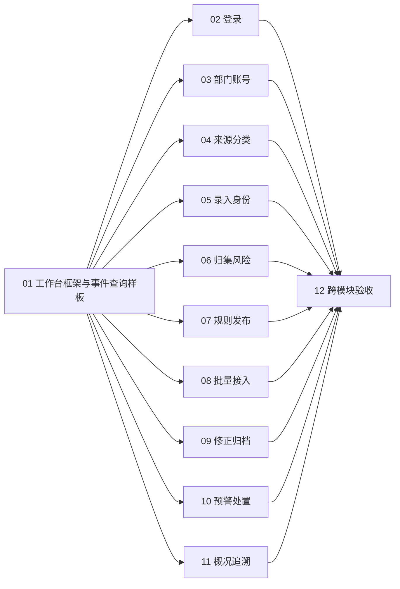

# 全项目 UI 美化 — 实施任务

用户已确认设计方案和 12 项任务拆分，现已发布本地 Markdown 任务。01–04 已实现并验收通过，其余任务保持 ready-for-agent。

来源：[UI 美化设计](../../docs/UI美化设计.md)。审阅记录：[任务拆分草案](../../docs/UI美化任务拆分草案.md)。正式任务及后续验收证据以本目录逐项文件为准。

## 执行与完成规则

- 当前可开工：05–11；01 工作台框架与事件查询样板、02 登录页与身份反馈、03 部门与账号管理、04 来源与分类维护已完成。
- 仅当前置任务全部为 done 时可开工；ready-for-agent 不代表无阻塞、已实现或测试通过。
- 02–11 直接依赖 01，彼此不构成业务阻塞；涉及共同界面时应协调修改范围。12 依赖 02–11。
- 每项交付完整可演示的现有业务流程及必要验证；UI 改版保持业务规则、权限、接口和数据口径。
- 完成时只勾选有证据的验收项，在对应任务的 Comments 中记录检查命令、结果、截图位置及限制，再将状态改为 done。
- 共同行为约束已写入每项任务；本批与既有 32 项业务交付任务独立跟踪。

## 任务索引

| 编号 | 任务 | 直接前置 | 状态 |
|---|---|---|---|
| 01 | [工作台框架与事件查询样板](issues/01-workspace-event-query.md) | 无 | done |
| 02 | [登录页与身份反馈](issues/02-login-feedback.md) | 01 | done |
| 03 | [部门与账号管理](issues/03-department-accounts.md) | 01 | done |
| 04 | [来源与分类维护](issues/04-sources-classifications.md) | 01 | done |
| 05 | [事件录入与身份处理](issues/05-event-intake-identity.md) | 01 | ready-for-agent |
| 06 | [归集与风险研判](issues/06-consolidation-risk.md) | 01 | ready-for-agent |
| 07 | [规则草稿、预览与发布](issues/07-rule-publication.md) | 01 | ready-for-agent |
| 08 | [批量导入、映射与接入管理](issues/08-batch-import-access.md) | 01 | ready-for-agent |
| 09 | [来源修正与档案归档审核](issues/09-archive-change-review.md) | 01 | ready-for-agent |
| 10 | [预警研判与部门处置](issues/10-warning-case-handling.md) | 01 | ready-for-agent |
| 11 | [业务概况、导出与操作追溯](issues/11-insights-export-history.md) | 01 | ready-for-agent |
| 12 | [全项目一致性与跨模块验收](issues/12-cross-module-verification.md) | 02–11 | ready-for-agent |

## 依赖图

