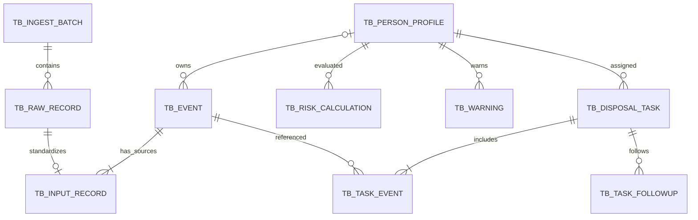

# 数据模型设计

依据：[需求规格](需求规格.md)。本文件为实现前设计，不是已执行的数据库迁移。新增表名与内部状态编码是建议；已确认的业务语义不可因技术选型改变。

## 1. 统一约定与兼容

沿用 MySQL 8.0、InnoDB、`utf8mb4`、`utf8mb4_0900_ai_ci`、小写蛇形命名。技术主键为 `BIGINT UNSIGNED AUTO_INCREMENT`；布尔值使用 `TINYINT UNSIGNED`；审计字段沿用 `gmt_create`、`gmt_modified`、`created_by`、`modified_by`、`is_deleted`，可并发修改的实体保留 `version`。

`tb_input_record` 现有 29 个字段全部保留，不改名、不删除。类型和原有默认值以用户提供的“纠纷事件记录主表”章节为基准。本文件不重建 `tb_flow_petition` 的完整信访流程。

## 2. 三层事件与档案

三层职责：

1. 原始记录：接收的完整内容、来源和结果，包括导入失败、重复提交等接收痕迹。
2. `tb_input_record`：每个来源的标准化上报记录，保留部门归属和原始追溯。跨部门上报不能因合并被覆盖。
3. `tb_event`：确认同一真实事件后的统一业务实体，关联人员，承载有效计数及事件办结。多条来源记录可以关联同一有效事件。

人员风险只计算 `tb_event` 层的有效事件，不直接对上报表 `COUNT(*)`。档案详情需区分“有效事件数”与“来源上报数”。

## 3. 既有主表扩展

建议为 `tb_input_record` 新增以下字段，均不替换既有字段：

| 新增字段 | 建议类型 | 含义 |
|---|---|---|
| `department_id` | BIGINT UNSIGNED | 上报归属部门，来自账号或凭据。 |
| `data_source_id` | BIGINT UNSIGNED | 数据来源实体，与原有 `event_source` 展示文本区分。 |
| `raw_record_id` | BIGINT UNSIGNED | 对应原始接收记录。 |
| `ingest_batch_id` | BIGINT UNSIGNED，可空 | 文件或接口批次。 |
| `canonical_event_id` | BIGINT UNSIGNED，可空 | 归集的统一事件；未确认前可空。 |
| `reporter_user_id` | VARCHAR(50)，可空 | 真实上报用户；接口接入可由凭据识别主体。 |
| `credential_id` | BIGINT UNSIGNED，可空 | 接口凭据引用，不存明文密钥。 |
| `external_record_id` | VARCHAR(128)，可空 | 外部记录编号，配合来源建立幂等键。 |
| `ingest_channel` | VARCHAR(24) | 表单、CSV、xlsx、API。 |
| `is_special_source` | TINYINT UNSIGNED | 接收时的可信特殊来源快照。 |
| `identity_review_state` | VARCHAR(32) | 身份匹配或审核状态。 |
| `duplicate_review_state` | VARCHAR(32) | 待检测、疑似、独立、确认重复等。 |
| `content_revision` | INT UNSIGNED | 支持变更、命中及修正申请绑定具体版本。 |

既有字段职责：

- `matched_person_id`、`matched_at` 为人员关联快照；风险归集以统一事件的人员关联为准，不能双重计数。
- `match_status`、`review_status` 继续保留，内部枚举及兼容映射在建库时明确；不能直接用原有 `review_status=1` 的默认值跳过身份或重复审核。
- `keyword_tags` 为展示快照，命中事实另表存储。
- `event_risk_level` 为事件层展示或快照字段，不能作为人员最终风险的权威字段。具体显示含义在接口设计中明确，避免与档案最终等级混用。
- `storage_path`、`error_path` 保留；批次及文件表负责文件元数据与权限，不能通过直接拼接路径绕过授权。
- `is_completed` 保留为统一事件办结状态的同步快照；规范事件状态是权威来源。

同一来源外部编号重复提交时保留新的原始接收结果，引用已有标准化记录，不重复插入新的有效业务记录；跨来源编号相同不代表同一事件。

## 4. 配套实体

### 4.1 账号、部门和来源

| 表 | 核心内容 |
|---|---|
| `tb_department` | 部门名称、类型、状态；特殊账号不作为部门。 |
| `tb_user` | 稳定用户 ID、登录标识、密码摘要、归属部门、状态。 |
| `tb_role` / `tb_permission` | 角色与操作权限定义。 |
| `tb_user_role` / `tb_role_permission` | 角色兼任和权限关联。 |
| `tb_data_source` | 来源名称、类型、状态、归属或允许接入范围。 |
| `tb_api_credential` | 凭据摘要、来源、部门、特殊上报权限、有效状态。 |
| `tb_dictionary_item` | 事件类别、纠纷类型等字典项和状态。 |
| `tb_source_mapping` / `tb_source_mapping_item` | 来源字段映射、类型转换、字典别名及配置版本。 |

接口凭据的特殊权限与账号的特殊权限都在接收时固化来源证据，不能被后续文件内容、账号改角色或事件合并悄悄改写。

### 4.2 接入与统一事件

| 表 | 核心内容 |
|---|---|
| `tb_ingest_batch` | 渠道、来源、归属、实际操作者、映射版本、行数与成功失败重复数、进度。 |
| `tb_raw_record` | 原始编号或行号、原始内容、校验结果、错误原因、标准化记录引用。 |
| `tb_file_asset` | 原始文件、错误文件或业务附件的元数据与授权归属。 |
| `tb_event` | 主要当事人、规范发生时间与描述、分类、有效性、归档及办结状态、版本。 |
| `tb_duplicate_candidate` | 候选事件对、时间差、相似度、规则版本、证据及审核结论。 |
| `tb_review_case` | 身份或重复审核事项、候选、决定、原因、操作者、处理时间。 |
| `tb_change_request` | 修正或删除申请、目标版本、原值、新值、原因、状态及审核结果。 |
| `tb_record_revision` | 标准化记录及统一事件的历史版本，支持变更追溯。 |

原始内容不被标准化或修正覆盖。合并后的事件描述、分类、发生时间等由审核确认；来源原文仍各自保留，不自动用最后一次上报覆盖统一事件。

### 4.3 人员与风险

| 表 | 核心内容 |
|---|---|
| `tb_person_profile` | 身份与联系方式、有效事件数、最近事件时间、当前规则等级与最终等级、计算版本和状态。 |
| `tb_profile_change` | 人员修正、合并、拆分、事件迁移的前后关系及审核理由。 |
| `tb_risk_rule_set` / `tb_risk_rule` | 规则集草稿和发布版本、次数阈值、单词或组合词、目标等级、启停状态。 |
| `tb_keyword_hit` | 来源记录、事件、文本版本、规则版本、命中词、文本位置或片段、人工标签依据。 |
| `tb_keyword_exclusion` | 被排除的命中或规则实例、对应文本和规则版本、原因、有效状态。 |
| `tb_risk_calculation` | 人员、计算序号、数据版本、规则版本、计数、基础等级、规则等级、最终等级与时间。 |
| `tb_risk_evidence` | 对应计算的规则、事件、来源和命中证据、特殊来源证据。 |
| `tb_risk_adjustment` | 人工等级、原因、关联计算或数据版本、有效状态及失效原因。 |

身份证号唯一识别应在身份确认后落实唯一约束或等效事务校验。姓名和手机号组合不能全局强制唯一：共享手机号等冲突必须能进入审核，而不是通过覆盖旧档案解决。

计算结果至少区分：基础等级、规则等级、有效人工调整、最终等级、特殊来源保底。规则历史和证据必须能解释某次计算，不只保存最新规则对应的一个分数。

### 4.4 预警和处置

| 表 | 核心内容 |
|---|---|
| `tb_warning` | 人员、风险触发原因、关联计算、状态、研判期限、最新信息标记、关闭结论。 |
| `tb_warning_update` | 同一预警的新增事件、升级、依据更新及重新研判记录。 |
| `tb_disposal_task` | 人员、承办部门、期限、状态、派发快照、中心选定的授权内容。 |
| `tb_task_event` | 任务与事件关联，至少一条；派发时的事件版本或快照。 |
| `tb_task_followup` | 跟进内容、附件、提交人、时间。 |
| `tb_task_review` | 每轮结果提交、审核通过或退回、原因及明确办结的事件。 |
| `tb_task_relation_confirmation` | 归档变化导致暂停后的确认、调整和恢复记录。 |
| `tb_operation_log` | 关键操作主体、时间、对象、前后变化、原因与结果。 |
| `tb_background_job` | 导入、规则预览和重算任务的进度、版本、失败及恢复信息。 |

任务快照不能等同于完整档案快照向部门开放；部门接口只返回中心明确授权的字段、摘要和附件。派发后人员资料变更也不能自动扩张这份授权。

## 5. 状态与顺序

建议内部使用明确的枚举或状态列，避免单一整数混合所有业务阶段。

| 对象 | 关键状态与约束 |
|---|---|
| 原始接入行 | 接收、校验失败、标准化成功、幂等重复；成功不代表已计入风险。 |
| 身份审核 | 待匹配、已关联、待人工、已确认；无可靠身份不能建档。 |
| 重复审核 | 待检测、疑似待审、确认独立、确认重复；身份未明确不能完成业务合并。 |
| 有效事件 | 仅人员已确认、重复已明确、未逻辑删除才计数；办结不移出统计。 |
| 修正申请 | 待审核、通过、驳回；待审核期间旧版本有效。 |
| 规则集 | 草稿、预览、发布、历史；预览与发布应校验基于的数据版本。 |
| 风险预警 | 待研判、跟进中、已关闭；关闭必须有中心结论。 |
| 处置任务 | 待处理、处理中、待中心审核、退回补充、已关闭；另存归档变更暂停标识。 |

超期和“有新增信息”是独立标识，不能覆盖任务或预警的业务状态。任务提交后待中心审核不再累计部门逾期，审核等待时间另外统计。

## 6. 风险失效与重算矩阵

| 变更 | 行为 |
|---|---|
| 新增有效事件、有效事件删除或恢复 | 重算所属人员，失效相关人工调整，评估预警。 |
| 事件重新归档、档案合并拆分 | 重算原、新档案；保留历史，检查未关闭任务关联。 |
| 风险文本、标签、类型或特殊来源有效关联变化 | 按影响重识别命中、重算；不因合并丢失特殊来源。 |
| 排除或恢复关键词命中 | 更新对应事件依据并重算，不突破特殊来源保底。 |
| 新规则发布 | 对受影响档案批量重算，绑定新版本，按要求失效人工调整。 |
| 任务或事件办结 | 不减少有效事件数，不因办结自动降级。 |
| 仅无关联系方式更新 | 不无故失效人工调整；若引起身份归档变化按归档变更处理。 |

## 7. 一致性与索引建议

- 上报来源外部编号建立来源范围内幂等约束；请求重试仍保留接收痕迹。
- 批次原始行定位、事件关联来源、人员有效事件、部门上报列表、开放预警和部门任务期限建立对应查询索引。
- 部门权限在服务端查询条件与对象授权中实施，列表、详情、导出、附件下载采用一致范围。
- 审核通过、归档关联和有效性变化使用事务及版本校验，防止两个审核人同时做出相反决定。
- 风险批量重算使用数据版本和规则版本防止旧结果覆盖新结果；展示计算进度，不把未完成结果当成最新结论。
- 重算失败可追踪和恢复；重复运行不能重复生成有效事件或相同开放预警。
- 事件迁移需同时覆盖旧、新人员的统计和风险；不能只重算迁入档案。
- 所有来源合并后只计一次有效事件，但证据逐来源留存；特殊来源保底由有效事件关联的可信来源证据推导。
- 逻辑删除、修正和拆分不硬删除原始数据、已发布规则、历史计算、审批记录和已关闭任务快照。

## 8. 后续实现细化

具体框架版本、Java 版本、迁移工具、内部状态数值、相似度算法及阈值初始值在实现时选择并记录。除已确认的 3 天候选窗口、7 天未研判提醒和初始风险次数阈值外，不把未讨论的数值冒充用户已确认的要求。

这里未提供可执行 SQL，也未声称上述索引或事务已经实现。初始化脚本应在模型落实为代码时与字段说明一起交付。
